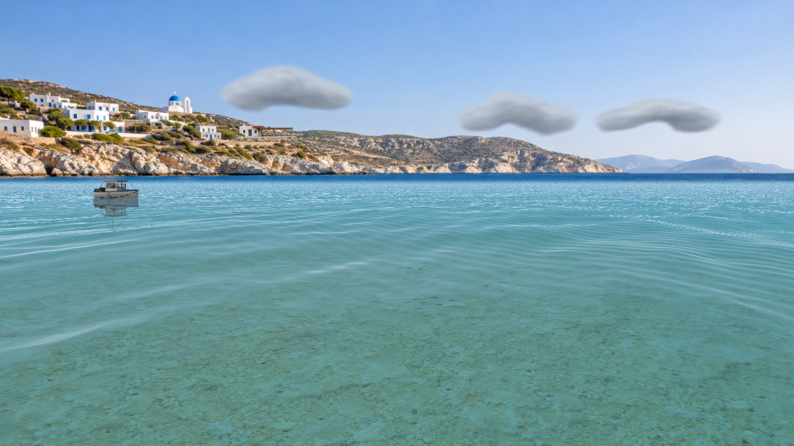

# Greek Coast

A Greek island screensaver for **XScreenSaver on Linux**. Enjoy clear coastal water, a hillside village and taverna, changing daylight, passing boats, and small shoals of Mediterranean fish.



[Night preview](docs/screenshots/night-preview.png) · [Island ferry](docs/screenshots/ferry.png) · [Sailing caique](docs/screenshots/sailing.png)

The fishing boat, island ferry, and sailing caique take turns—only one is visible at a time. Village activity, boats, fish, clouds, and the day/night cycle can be adjusted in XScreenSaver's Settings panel.

## Requirements

- Linux with an X11 desktop session and XScreenSaver already installed.
- An OpenGL 3.3 or newer graphics driver. Integrated graphics can use the Low detail setting.
- CMake 3.20+, a C++17 compiler, pkg-config, Qt 6.2+ Core/Gui/Widgets, libepoxy, Xlib, EGL, and libpng development packages.
- Python 3 for registering the screensaver. Pillow is optional and enables additional tests.
- GTK 3 development packages only for the optional installation without administrator access.

All artwork is included. **No API key, account, or internet connection is needed to run it.** Native Wayland support is not provided; use an X11 session.

On Debian or Ubuntu, install the dependencies with:

```sh
sudo apt install build-essential cmake pkg-config libepoxy-dev libx11-dev \
  libegl1-mesa-dev libpng-dev qt6-base-dev xscreensaver xscreensaver-gl \
  python3 python3-pil
```

For other distributions, install the equivalent packages using their package manager.

## Install

Download this repository as a ZIP and extract it, or clone it. Open a terminal in the project directory, then run:

```sh
cmake -S . -B build -DCMAKE_BUILD_TYPE=Release -DCMAKE_INSTALL_PREFIX=/usr
cmake --build build --parallel
ctest --test-dir build --output-on-failure
sudo cmake --install build
greek-coast-register
```

If XScreenSaver is newly installed, open its Settings once before registration to create your initial preferences. Run the last command as your normal user, **without sudo**. It adds Greek Coast to your screensaver list and backs up `~/.xscreensaver`. Existing timeout, lock, selection, and other screensaver settings are preserved.

Close and reopen **XScreenSaver Settings**, select **Greek Coast**, and click **Settings**. You can then preview it or include it in XScreenSaver's normal rotation.

This uses the same executable/configuration layout as other XScreenSaver add-ons. The `/usr` prefix above matches Debian/Ubuntu's standard configuration directory. If your distribution uses different locations, set `XSCREENSAVER_HACK_DIR` and `XSCREENSAVER_CONFIG_DIR` when configuring CMake. For example, a distribution using `/usr/lib/xscreensaver` can use `-DXSCREENSAVER_HACK_DIR=lib/xscreensaver`. Without an explicit prefix, CMake defaults to `/usr/local`; check that XScreenSaver can find the configuration XML there.

## Install for your user only

Use this option if you cannot install system-wide. The build dependencies must already be available; this option also needs `libgtk-3-dev` or your distribution's equivalent.

```sh
cmake -S . -B build-user -DCMAKE_BUILD_TYPE=Release \
  -DCMAKE_INSTALL_PREFIX="$HOME/.local" -DGREEK_COAST_SETTINGS_BRIDGE=ON
cmake --build build-user --parallel
cmake --install build-user
"$HOME/.local/bin/greek-coast-register" --settings-bridge
```

The optional compatibility launcher makes the native Settings button work with a user-local installation. Close every open XScreenSaver Settings window and reopen it from the application menu after registration.

## Configure

The Settings panel groups related choices into two compact columns:

| Choices | What they do |
| --- | --- |
| **Time** | Greece clock follows the current date, season, and local time. Accelerated mode uses the selected speed. |
| **Speed** | Choose 0.1×, 0.5×, 1×, 2×, 5×, 10×, 25×, 50×, 100×, 200×, 500×, or 1000×. Each menu entry shows the duration of one simulated day. |
| **Water and sky** | Adjust wind, clouds, sun/moon visibility, camera drift, and compass direction. |
| **Village and sea** | Switch people/cars, the hillside taverna, passing boats, and fish shoals on or off. Adjust people size. |
| **Performance** | Select Low, Medium, or High detail and set a frame cap. Lower both if animation is slow. |

At 1×, a day lasts 24 hours. At 50× it lasts 28 minutes 48 seconds; at 200×, 7 minutes 12 seconds; at 1000×, 86.4 seconds. Acceleration changes daylight and lighting; people, boats, fish, and waves keep moving at ordinary speed.

Fish are easiest to see in the clear foreground water during daylight. Each boat takes a few minutes to cross before another type appears. Nighttime brings village, taverna, and boat lights.

Save your choices and restart the preview to apply them. The optional standalone settings window provides extra starting-date and Greek-location controls; open it with `/usr/libexec/xscreensaver/greek-coast --settings` for the system installation, or `~/.local/libexec/xscreensaver/greek-coast --settings` for a user installation.

## Update

Download or pull the new version, then repeat the configure, build, test, and install commands for your chosen installation method. Run registration again if the installation path changed; it updates the existing Greek Coast entry rather than adding duplicates. Close and reopen XScreenSaver Settings after an update.

## Uninstall

For a system installation:

```sh
greek-coast-register --remove
sudo cmake --build build --target uninstall
```

For a user installation:

```sh
"$HOME/.local/bin/greek-coast-register" --remove
cmake --build build-user --target uninstall
```

Keep the original build directory until uninstalling: it contains the list of installed files. Personal preferences and backups are preserved. Removing a user-local registration also restores its previous Settings launcher preference.

## Troubleshooting

- **Not listed:** run registration as your normal user, then reopen XScreenSaver Settings.
- **Settings button missing:** check the configurator XML directory for a system install, or use the user-local compatibility option above.
- **New options not showing:** fully close and reopen XScreenSaver Settings after an update.
- **Slow animation:** try Low detail and a 30 FPS cap, then disable clouds if needed.
- **Tests skipped:** native preview/settings tests need an accessible X11 display. Offscreen rendering tests can still run without one.

## License

Greek Coast code and generated artwork are provided under the [MIT license](LICENSE). Third-party libraries retain their own licenses; see the [dependency and license audit](THIRD_PARTY_NOTICES.md). The application uses system libraries and does not require downloading artwork at runtime.

For contribution and release checks, see [CONTRIBUTING.md](CONTRIBUTING.md).
